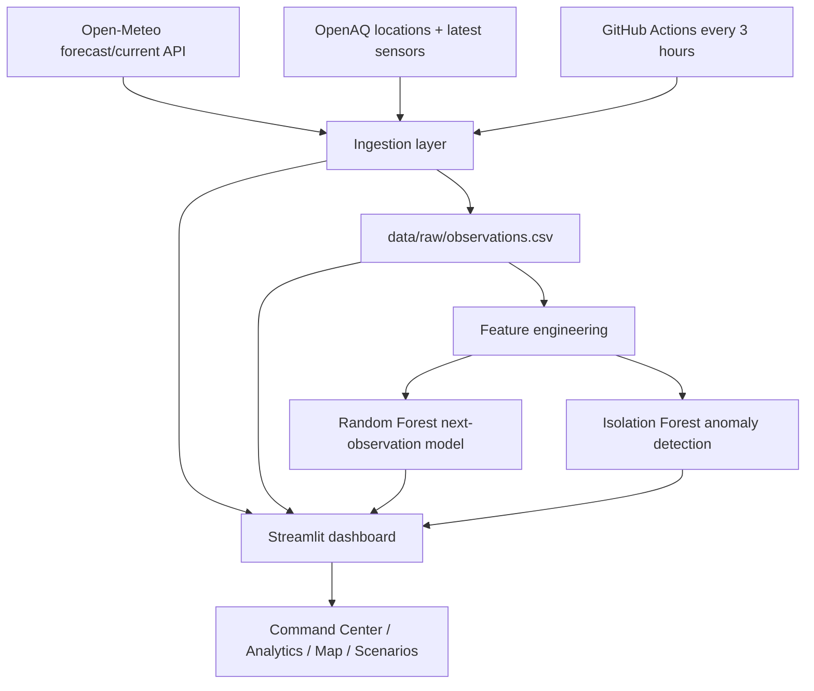

# CityPulse — Urban Stress Intelligence

**A Bengaluru-first urban environment monitoring and analytical platform.**

CityPulse combines modelled weather conditions, nearby air-quality sensor readings, an experimental composite environmental signal, a scheduled observation archive and data-driven analytical modules in a dark Streamlit command centre.

## Architecture



## Current features

- **Command Center:** live modelled weather, hourly outlook, nearby OpenAQ readings and the experimental CityPulse Index when its required inputs are present.
- **Environmental Analytics:** provider forecast plus archived weather and pollutant trends.
- **Predictive Intelligence:** a Random Forest model for the next scheduled apparent-temperature observation, trained only after at least 80 valid time-ordered training pairs and evaluated against a persistence baseline.
- **Anomaly Detection:** Isolation Forest over historical weather snapshots after at least 30 complete observations.
- **Zone Intelligence:** maps actual geocoded OpenAQ monitoring stations; it does not invent neighbourhood-level readings.
- **Scenario Simulator:** sensitivity analysis using adjustable temperature, particulate and rainfall assumptions.
- **Methodology:** data coverage, formula notes and explicit limitations.

## Pilot and data sources

- **Pilot city:** Bengaluru, Karnataka, India (12.9716° N, 77.5946° E)
- **Weather:** [Open-Meteo Forecast API](https://open-meteo.com/en/docs)
- **Air quality:** [OpenAQ API v3](https://docs.openaq.org/), authenticated with an `X-API-Key` header.

Open-Meteo provides modelled weather conditions and forecasts. OpenAQ provides public sensor observations where available; coverage and recency vary by location and pollutant.

## Experimental CityPulse Index

The initial project heuristic is:

```
Index = 0.50 × Heat + 0.35 × Particulate + 0.15 × Rain
```

- Heat is scaled from apparent temperature 22–40 °C into a 0–100 signal.
- Particulate is the higher of the citywide median PM2.5 and PM10 signals, normalized against 60 µg/m³ and 100 µg/m³ respectively.
- Rain is scaled from 0–10 mm into a 0–100 signal.
- PM readings older than 48 hours are excluded.
- The composite is withheld when current weather or recent PM2.5/PM10 data is missing.

**This is not India's official AQI.** The CPCB National AQI uses pollutant-specific breakpoints and prescribed averaging periods; this prototype uses latest sensor readings as inputs to a separate project heuristic. Do not interpret the index as a health assessment, public warning or government rating. Reference: [CPCB — About National Air Quality Index](https://airquality.cpcb.gov.in/ccr_docs/About_AQI.pdf).

## Automated observation collection

GitHub Actions runs `.github/workflows/data-collection.yml` every three hours and can also be started manually. It appends normalized, de-duplicated observations to `data/raw/observations.csv`.

Weather collection works without a key. OpenAQ collection requires a repository Actions secret:

1. Open **Settings → Secrets and variables → Actions**.
2. Choose **New repository secret**.
3. Set the name to `OPENAQ_API_KEY`.
4. Paste your private, active OpenAQ key and save.

Never commit a real key or put one in `.streamlit/secrets.toml.example`. The local `.streamlit/secrets.toml` file is ignored by Git.

## Run locally

```bash
python -m venv .venv
# Windows: .venv\Scripts\activate
# macOS/Linux: source .venv/bin/activate
pip install -r requirements-dev.txt
streamlit run app.py
```

For local OpenAQ access, create `.streamlit/secrets.toml`:

```toml
OPENAQ_API_KEY = "your-private-key"
```

## Deploy on Streamlit Community Cloud

1. Create a new app and select this repository: `SnehalTripathy/CityPulse`.
2. Select branch `main`.
3. Set **Main file path** to `app.py`.
4. Select Python 3.11 if the version picker is shown.
5. Under **Advanced settings → Secrets**, add:

```toml
OPENAQ_API_KEY = "your-private-key"
```

6. Deploy.

## Quality checks

GitHub Actions workflow `.github/workflows/ci.yml` compiles the Python modules and runs tests for the stress index, OpenAQ ingestion, observation storage and ML readiness.

## Important limitations

- City-level weather is modelled grid-cell data, not street-level sensor data.
- OpenAQ latest values may be asynchronous and station coverage is not uniform.
- The composite index is an experimental heuristic, not a regulatory AQI.
- ML pages remain in baseline-building mode until enough collected observations exist.
- The Random Forest prediction is an exploratory next-observation estimate, not a replacement for the Open-Meteo provider forecast.
- GitHub-hosted CSV storage is a simple pilot archive. A larger multi-city deployment should move observations to a managed time-series database/object store.

## Roadmap

1. Add historical sensor aggregation and stronger source-quality checks.
2. Evaluate a validated multi-dimensional urban stress index.
3. Add model monitoring, drift checks and explainability.
4. Expand to additional Indian cities after the Bengaluru pipeline is reliable.
5. Add report exports and operational alerts.
